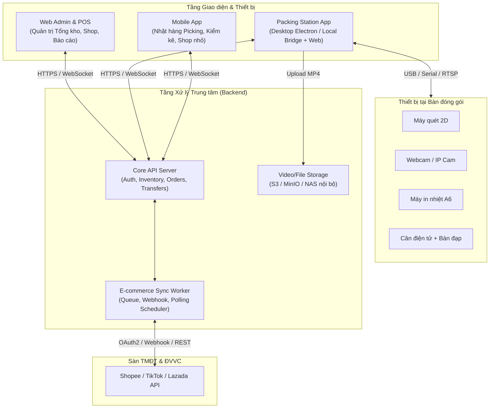
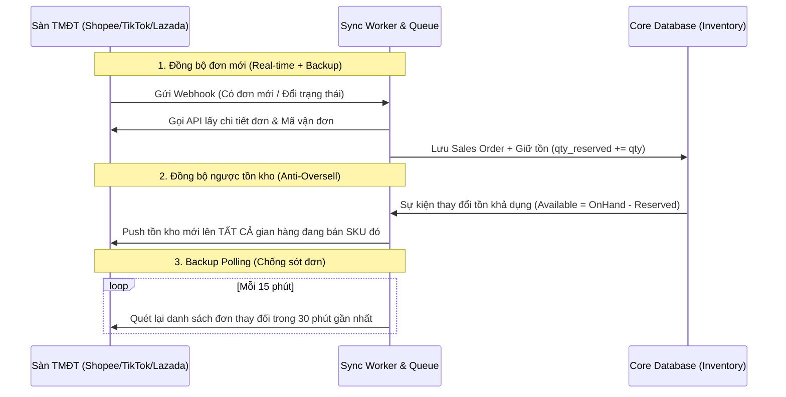

# Tài liệu Thiết kế Chi tiết: Phần mềm, Phần cứng, Quy trình Đóng gói & Đồng bộ Sàn TMĐT

Tài liệu này mở rộng từ bản [thiet-ke-he-thong-quan-ly-kho-va-shop.md](./thiet-ke-he-thong-quan-ly-kho-va-shop.md), đi sâu vào **kiến trúc kỹ thuật phần mềm**, **bố trí phần cứng trạm đóng gói**, **SOP đóng gói chi tiết** và **cơ chế đồng bộ đơn hàng / hoàn hàng với các sàn TMĐT**.

---

## 1. Thiết kế Kiến trúc Phần mềm (Software Design)

### 1.1. Kiến trúc tổng thể (System Architecture)

Do trình duyệt Web thông thường bị giới hạn quyền truy cập trực tiếp vào cổng USB/COM, máy in nhiệt và camera chuyên dụng ở tốc độ cao, hệ thống nên chia làm **4 thành phần**:



### 1.2. Cách Phần mềm Đóng gói giao tiếp Phần cứng (Local Hardware Bridge)
Tại bàn đóng gói, có 2 phương án kỹ thuật tốt nhất:
* **Phương án A (Khuyên dùng): Web App + Local Agent Bridge (chạy ngầm ở `localhost:9000`):**
  * Giao diện vẫn là Web App (dễ cập nhật, đồng bộ).
  * Cài thêm một dịch vụ nhỏ (viết bằng Node.js/Go/Python/C#) chạy ngầm trên PC đóng gói, mở WebSocket/HTTP cục bộ.
  * **Chức năng của Local Agent:**
    1. Nhận lệnh in từ Web -> Gửi thẳng file PDF/ZPL/TSPL tới **Máy in nhiệt** (bỏ qua hộp thoại Print của trình duyệt, in tức thì trong `< 0.5s`).
    2. Điều khiển **FFmpeg** quay video từ Webcam/IP Cam, tự động chèn `drawtext` (Mã vận đơn + Ngày giờ), cắt clip khi nhận lệnh Stop và đẩy ngầm lên Server/NAS.
    3. Đọc dữ liệu cổng COM/USB từ **Cân điện tử** gửi real-time lên màn hình Web.
* **Phương án B (Đóng gói Desktop App):** Dùng Electron/Tauri tích hợp sẵn toàn bộ driver in ấn, FFmpeg và đọc cổng Serial vào 1 file cài đặt `.exe`.

*(Lưu ý: Máy quét mã vạch 2D và Bàn đạp chân USB hoạt động ở chế độ **HID Keyboard** — giả lập bàn phím, nên Web App tự bắt được sự kiện bàn phím mà không cần driver phức tạp).*

### 1.3. Bảng dữ liệu bổ sung cho Đồng bộ Sàn & Hoàn hàng
* `marketplace_connections`: `id`, `shop_id`, `platform` (`SHOPEE`, `TIKTOK`, `LAZADA`), `seller_id`, `access_token`, `refresh_token`, `token_expires_at`, `is_active`.
* `order_sync_logs`: `id`, `platform`, `external_order_id`, `event_type`, `payload_json`, `status` (`PENDING`, `SUCCESS`, `FAILED`), `retry_count`, `created_at` (giúp truy vết và chạy lại nếu API sàn lỗi).
* `return_orders` (Đơn hoàn / Trả hàng):
  * `id`, `sales_order_id`, `return_type` (`DELIVERY_FAILED_RTS` - Giao thất bại hoàn về, `BUYER_RETURN_RMA` - Khách khiếu nại trả hàng).
  * `return_tracking_number`, `status` (`IN_TRANSIT`, `RECEIVED_QC`, `RESTOCKED`, `DISPUTED`).
  * `unboxing_video_url` (Video khui hàng hoàn làm bằng chứng khiếu nại sàn).
  * `qc_result` (`GOOD` - Nhập lại kho bán, `DAMAGED` - Kho hàng lỗi, `WRONG_ITEM` - Bị tráo hàng/thiếu hàng).

---

## 2. Thiết kế Phần cứng & Bố trí Trạm Đóng Gói (Workstation)

### 2.1. Sơ đồ bố trí 1 Bàn đóng gói chuẩn
Một bàn đóng gói tiêu chuẩn (kích thước mặt bàn khuyến nghị: `120cm x 70cm`, cao `75–80cm`) nên bố trí khoa học để nhân viên **không phải di chuyển bước chân** và **không chéo tay**:

```text
+-------------------------------------------------------------------+
|                   [ GIÁ TREO CAMERA (Cao 70-90cm) ]               |
|                         (Chiếu thẳng xuống)                       |
|                                                                   |
|   +--------------------+                  +-------------------+   |
|   | MÀN HÌNH PC (22")  |                  | MÁY IN NHIỆT A6   |   |
|   +--------------------+                  +-------------------+   |
|                                                                   |
|   [MÁY QUÉT 2D ĐỂ BÀN]        ( VÙNG ĐÓNG HÀNG )      [CÂN ĐIỆN TỬ]|
|   (Hướng ra phía trước)     (Nằm gọn trong khung       (Bên phải) |
|                              hình của Camera)                     |
+-------------------------------------------------------------------+
      ^                                                       ^
 [Rổ hàng đã nhặt]                                  [Bao tải / Kệ hàng chờ Ship]
                        [ BÀN ĐẠP CHÂN USB ] (Dưới gầm bàn)
```

### 2.2. Thông số kỹ thuật phần cứng đề xuất (1 Trạm)

| Thiết bị | Thông số kỹ thuật tối thiểu | Ghi chú vận hành |
| :--- | :--- | :--- |
| **PC / Mini PC** | CPU i3/i5 (gen 8+), RAM 8GB, SSD 256GB | Có ít nhất 4–5 cổng USB (Quét, In, Cam, Cân, Bàn đạp). |
| **Camera quay bàn** | Full HD 1080p, 30fps, góc rộng 90°–110° | Có lấy nét cố định (Fixed Focus) để không bị mờ khi tay đưa qua lại. |
| **Máy quét 2D** | Đa tia để bàn (Omnidirectional), đọc QR màn hình | Bật chế độ *Auto-sense* (tự quét khi có vật đi qua) + thêm hậu tố `Enter` sau mỗi lần quét. |
| **Máy in nhiệt** | Tốc độ $\ge$ 150mm/s, đầu in 203 DPI, khổ 100x150mm | Dùng giấy decal nhiệt cuộn/xấp đục lỗ xé rãnh sẵn. |
| **Lưu trữ Video** | Ổ cứng PC lưu tạm 7 ngày + NAS/Cloud lưu 90–180 ngày | 1 video 30s (720p/1080p nén H.264) nặng khoảng `3–5 MB`. 1.000 đơn/ngày $\approx$ `4 GB/ngày`. |

---

## 3. Quy trình Đóng gói & Xử lý Ngoại lệ (SOP)

### 3.1. Luồng chuẩn (Happy Path)
1. **Nhặt hàng (Picking):** Nhân viên nhặt gom theo *Pick List* (theo lô 20–50 đơn) đặt vào các rổ có mã vạch hoặc mang từng đơn ra bàn.
2. **Mở phiên đóng gói:** Nhân viên đưa **Phiếu nhặt hàng / Mã đơn** qua máy quét 2D $\rightarrow$ Hệ thống hiển thị danh sách SKU + ảnh sản phẩm lên màn hình $\rightarrow$ **Tự động bật quay Video**.
3. **Kiểm tra chéo (Scan-to-Pack):** Nhân viên quét mã vạch từng sản phẩm trước mặt máy quét rồi bỏ vào hộp/túi.
   * *Đúng SKU & đủ số lượng:* Màn hình báo xanh, phát âm thanh *Ting*.
   * *Sai SKU hoặc thừa số lượng:* Màn hình báo đỏ, phát còi *Bíp* cảnh báo, khóa nút hoàn tất.
4. **Cân & Dán tem:** Đặt kiện lên cân (tự động ghi nhận trọng lượng) $\rightarrow$ Đóng kín băng keo $\rightarrow$ Giẫm **Bàn đạp chân** (hoặc quét mã xác nhận):
   * Hệ thống **dừng quay video** và lưu thành `TrackingNumber.mp4`.
   * Máy in nhiệt **tự động nhả tem A6** $\rightarrow$ Nhân viên bóc dán lên hộp, bỏ vào bao tải theo từng ĐVVC.
5. **Bàn giao ĐVVC (Handover):** Cuối ca, nhân viên quét toàn bộ mã vận đơn trên bao tải giao cho shipper $\rightarrow$ In **Biên bản bàn giao** (2 bên ký) $\rightarrow$ Hệ thống **chốt xuất kho** (`qty_on_hand` giảm, ghi vào `stock_movements`).

### 3.2. Xử lý các tình huống ngoại lệ (Exception Handling)
* **Đơn bị khách hủy ngay lúc đang đóng gói:** Tại bước quét mở phiên hoặc bước bấm hoàn tất, hệ thống kiểm tra lại trạng thái Real-time từ Sàn. Nếu sàn báo `CANCELLED`, màn hình khóa đỏ ngay lập tức, **không in tem**, nhân viên trả hàng lại rổ hoàn.
* **Lệch trọng lượng bất thường:** Nếu trọng lượng thực tế chênh lệch `> 10%` so với tổng trọng lượng chuẩn của các SKU trong đơn, màn hình hiện cảnh báo vàng yêu cầu kiểm tra lại (tránh đóng thiếu quà tặng hoặc thừa hàng).
* **Mất kết nối Camera hoặc Máy in:** Phần mềm không cho phép đóng gói "mù" đối với đơn giá trị cao nếu Camera chưa sẵn sàng; có nút *In lại tem (Reprint)* có ghi log nhân viên thực hiện để tránh dán trùng tem cho 2 hộp khác nhau.

---

## 4. Kết nối, Đồng bộ Đơn hàng & Hoàn hàng với Sàn TMĐT

### 4.1. Kiến trúc đồng bộ 2 chiều (Webhook + Polling)



**Các nguyên tắc kỹ thuật bắt buộc khi tích hợp Sàn:**
* **Idempotency (Chống trùng lặp):** Dùng `external_order_id` + `platform` làm khóa duy nhất (Unique Key). Nếu sàn bắn Webhook 2 lần, hệ thống chỉ xử lý 1 lần.
* **Cơ chế Anti-Oversell (Chống bán vượt tồn):** Khi có 1 đơn Shopee chốt, Tổng kho trừ ngay vào `qty_reserved` $\rightarrow$ Tính lại `Available = qty_on_hand - qty_reserved` $\rightarrow$ Đẩy số tồn mới này lên **cả Shopee, TikTok, Lazada** qua hàng đợi (Queue) để tránh 2 khách ở 2 sàn khác nhau mua cùng 1 sản phẩm cuối cùng trong kho.
* **Tự động làm mới Token (OAuth2 Refresh):** Mỗi sàn có thời hạn `access_token` khác nhau (vài giờ đến vài ngày). Cần có Job chạy ngầm tự động refresh token trước khi hết hạn.

### 4.2. Quy trình Đồng bộ & Xử lý Hoàn hàng (Return / RTS / RMA)

Hoàn hàng TMĐT chia làm **2 luồng** với cách xử lý tồn kho hoàn toàn khác nhau:

1. **Luồng A: Giao hàng thất bại (RTS - Return to Sender)**
   * *Ngữ cảnh:* Shipper giao không thành công (khách không nghe máy, bom hàng), sàn cập nhật trạng thái `TO_RETURN` / `RETURNED`.
   * *Xử lý:* Hàng vẫn còn nguyên đai nguyên kiện từ kho đi ra. Khi shipper trả về kho:
     * Nhân viên mở tab **Nhận hàng hoàn**, quét mã vận đơn.
     * Camera **tự bật quay video quá trình khui kiểm tra**.
     * Nếu hàng nguyên vẹn $\rightarrow$ Chọn `QC: GOOD` $\rightarrow$ Hệ thống tạo phiếu nhập hoàn, cộng lại `qty_on_hand` tại Tổng kho.

2. **Luồng B: Khách đã nhận nhưng khiếu nại Trả hàng / Hoàn tiền (RMA)**
   * *Ngữ cảnh:* Khách mở hàng và bấm trả hàng trên sàn. Rủi ro **bị tráo hàng, dùng rồi, hoặc trả thiếu** rất cao.
   * *Xử lý:*
     * Đồng bộ yêu cầu trả hàng từ API sàn về bảng `return_orders` (kèm `return_tracking_number`).
     * Khi bưu kiện hoàn về tới kho: Quét `return_tracking_number` $\rightarrow$ Bắt buộc **quay video khui hàng** đối chiếu với `packing_video_url` lúc gửi đi.
     * **Nếu hàng bình thường:** Chuyển trạng thái `RESTOCKED` (Nhập kho bán lại hoặc kho thanh lý).
     * **Nếu bị tráo hàng / hư hỏng:** Chụp ảnh + lấy ngay 2 file video (*Video đóng gói lúc đi* + *Video khui hoàn lúc về*) $\rightarrow$ Bấm **Khiếu nại sàn (Dispute)** ngay trong thời hạn quy định của sàn (thường 24–48h sau khi nhận hoàn) để được sàn đền bù.
