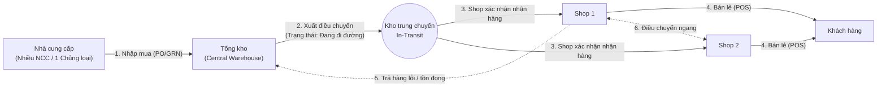
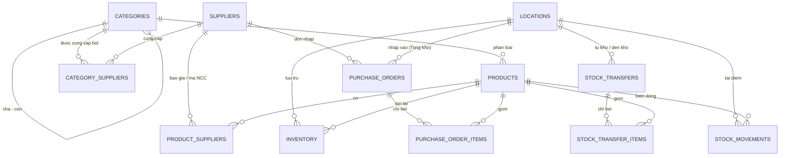
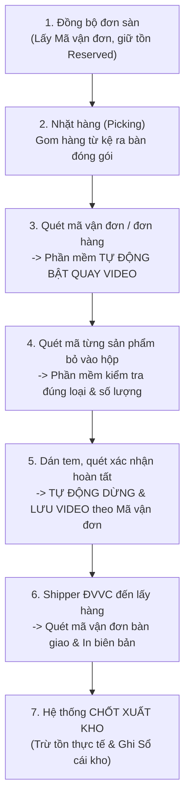

# Thiết kế Hệ thống Quản lý Tổng kho, Chuỗi Shop & Vận hành Đơn hàng TMĐT

Tài liệu tổng hợp kiến trúc nghiệp vụ, mô hình dữ liệu (Data Model), quy trình đóng gói đơn hàng sàn thương mại điện tử (TMĐT) và giải pháp phần cứng đi kèm cho mô hình **1 Tổng kho + Nhiều Shop (Offline & Online)**.

---

## 1. Các Shop có cần thiết kế kho riêng không?

Câu trả lời được tách làm 2 góc độ để đảm bảo hệ thống vừa chặt chẽ về dữ liệu, vừa gọn nhẹ khi vận hành:

* **Về mặt Dữ liệu (Database): KHÔNG tách bảng riêng.**
  * Không tạo bảng `ton_kho_tong` riêng và `ton_kho_shop_1`, `ton_kho_shop_2` riêng.
  * Xem **Tổng kho** và **từng Shop** đều là một **Điểm lưu trữ (`locations`)**, phân biệt bằng trường `type` (`CENTRAL` cho Tổng kho, `SHOP` cho cửa hàng).
  * *Lợi ích:* Mọi luồng luân chuyển (Tổng kho $\rightarrow$ Shop, Shop A $\leftrightarrow$ Shop B, Shop $\rightarrow$ Tổng kho) đều dùng chung **1 cơ chế Phiếu điều chuyển**, dễ dàng mở rộng lên hàng chục, hàng trăm shop mà không cần sửa cấu trúc phần mềm.

* **Về mặt Nghiệp vụ (Vận hành): CÓ quản lý tồn kho riêng cho từng Shop.**
  * Mỗi shop có số liệu tồn kho độc lập để biết chính xác từng điểm còn bao nhiêu hàng, bán tại shop nào thì trừ tồn của shop đó.
  * Tuy nhiên, tại các shop nhỏ không cần quản lý vị trí kệ/ngăn (Bin/Rack) phức tạp như ở Tổng kho.

---

## 2. Mô hình Quản lý Luồng hàng (Business Flow)

**Nguyên tắc vận hành cốt lõi:**
1. **Nhập tập trung tại Tổng kho:** Hàng từ NCC đi vào Tổng kho để kiểm soát chất lượng, dán tem mã vạch và tính giá vốn tập trung.
2. **Điều chuyển 2 bước (Có In-Transit):** Khi Tổng kho xuất đi Shop, hàng chuyển vào trạng thái *Đang vận chuyển*. Chỉ khi Shop kiểm đếm và xác nhận đã nhận, tồn kho của Shop mới tăng lên (tránh thất thoát trên đường giao).
3. **Sổ cái kho bất biến (Inventory Ledger):** Không sửa trực tiếp con số tồn kho bằng tay. Mọi biến động tăng/giảm đều phải phát sinh từ chứng từ (Nhập mua, Điều chuyển, Bán hàng, Kiểm kê).

---

## 3. Mô hình Dữ liệu (Data Model / ERD)

Giải quyết bài toán: **Có nhiều chủng loại, 1 chủng loại có thể có nhiều nhà cung cấp** và truy vết biến động tồn kho chính xác.

### Chi tiết các nhóm bảng chính:

1. **Hàng hóa, Chủng loại & Nhà cung cấp:**
   * `categories`: `id`, `name`, `parent_id` (hỗ trợ phân cấp chủng loại).
   * `suppliers`: `id`, `name`, `phone`, `address`, `tax_code`, `payment_terms`.
   * `category_suppliers` *(N-N)*: `category_id`, `supplier_id` (đánh dấu chủng loại nào do những NCC nào phụ trách).
   * `products` (hoặc `product_variants` nếu quản lý theo Size/Màu): `id`, `sku`, `barcode`, `name`, `category_id`, `unit`.
   * `product_suppliers`: `product_id`, `supplier_id`, `supplier_sku` (mã hàng phía NCC), `last_import_price`, `lead_time_days`.

2. **Điểm lưu trữ & Tồn kho tức thời:**
   * `locations`: `id`, `code`, `name`, `type` (`CENTRAL`, `SHOP`), `address`, `is_active`.
   * `inventory` *(Khóa chính: `location_id` + `product_id`)*:
     * `qty_on_hand`: Tồn thực tế tại điểm.
     * `qty_reserved`: Số lượng đang giữ chỗ cho đơn chưa xuất.
     * `qty_in_transit`: Số lượng đang trên đường chuyển đến.
     * `avg_cost`: Giá vốn bình quân gia quyền.

3. **Chứng từ giao dịch & Bán hàng TMĐT:**
   * `purchase_orders` & `purchase_order_items`: Đơn nhập từ `supplier_id` vào Tổng kho, lưu `unit_cost` thực tế từng lô.
   * `stock_transfers` & `stock_transfer_items`: Điều chuyển giữa `from_location_id` và `to_location_id`. Lưu `qty_shipped` và `qty_received` để đối soát thiếu/lệch.
   * `sales_orders` & `sales_order_items`:
     * `channel` (`SHOPEE`, `TIKTOK`, `LAZADA`, `POS_OFFLINE`...)
     * `shop_id` (doanh thu thuộc gian hàng/shop nào)
     * `fulfillment_location_id` (kho thực tế xuất hàng)
     * `tracking_number`, `carrier` (mã vận đơn & ĐVVC)
     * `packing_video_url`, `packed_by`, `packed_at`
   * `handover_manifests`: Biên bản bàn giao cho shipper ĐVVC (`id`, `carrier`, `shipper_name`, `handover_at`, `total_packages`).

4. **Sổ cái biến động kho (`stock_movements`):**
   * `id`, `location_id`, `product_id`, `movement_type` (`IMPORT_PO`, `TRANSFER_OUT`, `TRANSFER_IN`, `SALE`, `RETURN`, `ADJUSTMENT`), `ref_type`, `ref_id`, `qty_change`, `balance_after`, `unit_cost`, `created_at`, `created_by`.

---

## 4. Quy trình Đóng gói, Quay Video & Bàn giao ĐVVC (Đơn Online)

**Điểm mấu chốt vận hành:**
* **Quay video tự động theo mã vận đơn:** Quét mã đơn $\rightarrow$ tự bật quay (gắn watermark thời gian + mã vận đơn); quét xong $\rightarrow$ tự cắt clip lưu tên file theo `Mã_Vận_Đơn.mp4` để tra cứu trong 3 giây khi có khiếu nại.
* **Scan-to-Pack & Scan-to-Print:** Quét mã sản phẩm để kiểm tra đúng loại/số lượng; đóng xong quét xác nhận để máy in tự nhả đúng tờ tem vận đơn.
* **Chốt xuất kho lúc Bàn giao ĐVVC:** Chỉ trừ `qty_on_hand` khi shipper quét nhận hàng để tránh lệch tồn nếu khách hủy đơn khi hàng chưa rời kho.
* **Hoàn hàng (RTS):** Quét mã vận đơn hoàn $\rightarrow$ tự bật quay video khui hàng $\rightarrow$ nhập lại kho (hàng tốt hoặc hàng lỗi).

---

## 5. Phần cứng Đóng gói & Giải pháp thay thế bằng Điện thoại

### A. Bộ phần cứng chuyên dụng cho Bàn đóng gói tốc độ cao (15–30 giây/đơn)

| Thiết bị | Loại khuyên dùng | Tác dụng |
| :--- | :--- | :--- |
| **Máy quét mã vạch** | **2D để bàn đa tia** (Hands-free) | Quét nhanh `0.1s`, rảnh cả 2 tay để cầm hàng và dán băng keo. Đọc được mã QR trên phiếu sàn. |
| **Máy in nhiệt** | **Khổ A6 (100x150mm)**, USB/LAN | In tem decal bóc dán trực tiếp, không cần mực, tự động in ngay khi quét xong đơn. |
| **Camera đóng gói** | **Webcam Full HD góc rộng** / IP Cam | Treo trên cao chiếu thẳng xuống mặt bàn, kết nối phần mềm để tự động Start/Stop. |
| **Bàn đạp chân USB** | Foot Pedal (1–2 nút) | Giẫm chân thay phím `Enter`/`Space` để dừng video và in tem, không cần rời tay khỏi hộp hàng. |
| **Cân điện tử** *(Tùy chọn)* | Cân bàn cổng USB/RS232 | Tự động đối chiếu trọng lượng thực tế với trọng lượng chuẩn của đơn để phát hiện đóng thiếu/thừa. |

### B. Có nên thay thế hết bằng Phần mềm Điện thoại không?

**Kết luận:** Chỉ nên dùng điện thoại khi sản lượng nhỏ (**< 30–50 đơn/ngày**) hoặc cho các khâu cần di chuyển; **không nên** thay thế tại bàn đóng gói chuyên nghiệp.

* **Lý do điện thoại không phù hợp làm Bàn đóng gói lớn:**
  * Xung đột góc quay (gắn cố định trên cao thì khó đưa hàng sát vào quét mã; cầm tay thì vướng).
  * Camera lấy nét chậm với mã vạch nhỏ/nhăn trên bao bì.
  * Quay và giải mã QR liên tục nhiều giờ gây nóng máy, chai pin, giật lag và nhanh đầy bộ nhớ.
* **Mô hình kết hợp tối ưu nhất:**
  * **Dùng App điện thoại cho:** Nhân viên đi **Nhặt hàng (Picking)** trên kệ, **Kiểm kê kho**, và xử lý đơn tại **Shop bán lẻ ít đơn online** (5–10 đơn/ngày).
  * **Dùng PC + Phần cứng rời cho:** **Bàn đóng gói tại Tổng kho** (> 50 đơn/ngày). Tổng chi phí phần cứng rời chỉ khoảng **2 – 3 triệu đồng/bàn** (tận dụng PC/Laptop cũ), nhưng tốc độ gấp 3–4 lần và chạy bền bỉ 8–12 tiếng/ngày.
  * *Mẹo tiết kiệm (Phương án lai):* Có thể tận dụng điện thoại cũ làm **Webcam** gắn trên cao truyền hình ảnh về máy tính, nhưng vẫn nên mua **máy quét mã vạch 2D rời** cắm vào máy tính để quét cho nhanh.
