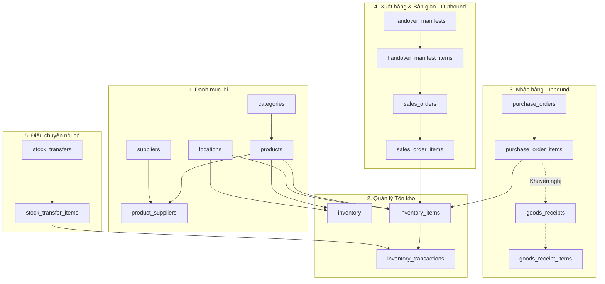

# Tài liệu thiết kế cơ sở dữ liệu -- Hệ thống quản lý tổng kho, cửa hàng và đơn hàng

**Phiên bản:** 1.1\
**Phạm vi:** Một tổng kho, nhiều cửa hàng/điểm lưu kho, bán hàng online
và offline; quản lý sản phẩm theo IMEI/Serial hoặc theo lô/số lượng.

---

## 1. Mục tiêu và nguyên tắc thiết kế

Hệ thống cần trả lời được các câu hỏi:

- Hiện mỗi sản phẩm còn bao nhiêu ở từng kho/cửa hàng?
- Với hàng có IMEI/Serial: chính xác từng chiếc đang ở đâu, trạng thái
  gì, giá vốn bao nhiêu?
- Với hàng số lượng lớn: hàng thuộc lô nhập nào, lô còn bao nhiêu và
  giá vốn mỗi đơn vị là bao nhiêu?
- Một sản phẩm đã được nhập từ nhà cung cấp nào, theo chứng từ nào?
- Một sản phẩm đã được điều chuyển, xuất bán, trả hàng hoặc điều chỉnh
  qua những nghiệp vụ nào?
- Đơn hàng thuộc gian hàng/kênh nào và hàng thực tế được xuất từ đâu?
- Ai thực hiện thao tác, vào thời điểm nào?

### 1.1. Nguyên tắc cốt lõi

1.  **Chứng từ thể hiện ý định/nghiệp vụ kinh doanh.** Ví dụ: đặt mua
    hàng, khách đặt hàng.
2.  **Dữ liệu tồn kho thể hiện hàng thực tế.** Ví dụ: IMEI cụ thể hoặc
    lô hàng thực tế đã nhận.
3.  **Giao dịch kho ghi nhận biến động đã xảy ra.** Không ghi nhận xuất
    kho chỉ vì đơn bán vừa được tạo.
4.  **Không sửa trực tiếp lịch sử đã ghi nhận.** Sai sót được xử lý bằng
    giao dịch đảo hoặc điều chỉnh có tham chiếu.
5.  **Tồn kho tổng hợp là dữ liệu phục vụ truy vấn nhanh.** Phải được
    cập nhật đồng bộ với giao dịch chi tiết.
6.  **Mọi thay đổi tồn kho phải nằm trong database transaction.** Cập
    nhật item/lô, giao dịch kho và số tổng hợp phải thành công hoặc
    rollback cùng nhau.
7.  **Không dùng một trạng thái cho nhiều khái niệm.** Trạng thái đơn
    hàng, trạng thái giao hàng và trạng thái tồn kho cần được tách
    riêng.

---

## 2. Phân loại cách quản lý sản phẩm

Trong bảng `products`, sử dụng trường `tracking_type` để xác định cách
theo dõi tồn kho.

---

Giá trị Ý nghĩa Ví dụ

---

`SERIALIZED` Theo dõi từng đơn vị Điện thoại, laptop
vật lý bằng IMEI/Serial

`BATCH` Theo dõi theo lô có Cáp sạc, tai nghe cùng
cùng đặc tính quản lý lô
và giá vốn

`QUANTITY` Chỉ theo dõi tổng số Bao bì, vật tư tiêu hao
lượng, không cần truy  
 xuất lô

---

`BATCH` và `QUANTITY` có thể cùng dùng bảng `inventory_items` theo dạng
lô. Khác biệt là `BATCH` yêu cầu truy xuất nguồn gốc lô chặt chẽ hơn;
`QUANTITY` có thể dùng cách quản lý đơn giản hơn nếu nghiệp vụ không cần
truy xuất từng lô.

Không phân loại sản phẩm thành "giá cố định" và "giá biến động". Giá vốn
được ghi nhận theo từng lần nhận hàng hoặc từng đơn vị IMEI. Một sản
phẩm có thể có nhiều mức giá vốn tại các thời điểm khác nhau.

---

## 3. Sơ đồ quan hệ tổng quát

<!-- ```text
categories ───────────────┐
                          v
                       products
                          |
             +------------+-------------+
             |            |             |
             v            v             v
      product_suppliers inventory_items inventory
             |            |
             v            v
         suppliers  inventory_transactions
                          ^
                          |
purchase_orders       sales_orders
       |                   |
       v                   v
purchase_order_items  sales_order_items
       |                   |
       +------ inventory_items
       |
       +------ goods_receipts / goods_receipt_items (khuyến nghị)

locations
   |          |
   +----------+---- inventory_items
   |
   +--------------- inventory

stock_transfers / stock_transfer_items
   |
   +--------------- inventory_transactions

handover_manifests / handover_manifest_items
   |
   +--------------- sales_orders

audit_logs: ghi nhận thao tác người dùng trên các nghiệp vụ quan trọng
```

Sơ đồ trên là định hướng logic. Quan hệ khóa ngoại cụ thể cần được triển
khai theo database engine và quy tắc xóa dữ liệu của hệ thống. -->

## Luồng dữ liệu & Liên kết bảng



> **System Logging:** `audit_logs` ghi nhận toàn bộ lịch sử thao tác của người dùng trên các phân hệ trên.

---

# PHẦN A -- DANH MỤC VÀ CẤU HÌNH NỀN TẢNG

## 4. Bảng `categories` -- Danh mục sản phẩm

### Công dụng

Phân loại sản phẩm để tìm kiếm, lọc, thống kê và lập báo cáo.

### Cấu trúc đề xuất

| Trường        | Kiểu dữ liệu gợi ý | Bắt buộc | Ý nghĩa               |
| ------------- | ------------------ | :------: | --------------------- |
| `id`          | BIGINT / UUID      |    Có    | Khóa chính            |
| `code`        | VARCHAR(50)        |    Có    | Mã danh mục, duy nhất |
| `name`        | VARCHAR(255)       |    Có    | Tên danh mục          |
| `description` | TEXT               |  Không   | Mô tả                 |
| `is_active`   | BOOLEAN            |    Có    | Còn sử dụng hay không |
| `created_at`  | TIMESTAMP          |    Có    | Ngày tạo              |
| `updated_at`  | TIMESTAMP          |    Có    | Ngày cập nhật         |

### Nghiệp vụ sử dụng

- Khi tạo sản phẩm, chọn một danh mục.
- Báo cáo doanh thu/tồn kho có thể lọc theo danh mục.
- Không xóa danh mục đã được sản phẩm sử dụng; nên chuyển
  `is_active = false`.

**Lưu ý:** Thiết kế hiện tại dùng danh mục một cấp. Chỉ bổ sung
`parent_id` nếu sau này thực sự cần cây danh mục cha--con.

---

## 5. Bảng `suppliers` -- Nhà cung cấp

### Công dụng

Lưu thông tin các đơn vị/cá nhân cung cấp hàng hóa.

| Trường          | Kiểu dữ liệu gợi ý | Bắt buộc | Ý nghĩa               |
| --------------- | ------------------ | :------: | --------------------- |
| `id`            | BIGINT / UUID      |    Có    | Khóa chính            |
| `code`          | VARCHAR(50)        |    Có    | Mã nhà cung cấp       |
| `name`          | VARCHAR(255)       |    Có    | Tên nhà cung cấp      |
| `phone`         | VARCHAR(30)        |  Không   | Số điện thoại         |
| `email`         | VARCHAR(255)       |  Không   | Email                 |
| `address`       | TEXT               |  Không   | Địa chỉ               |
| `tax_code`      | VARCHAR(50)        |  Không   | Mã số thuế            |
| `payment_terms` | VARCHAR(255)       |  Không   | Điều khoản thanh toán |
| `note`          | TEXT               |  Không   | Ghi chú               |
| `is_active`     | BOOLEAN            |    Có    | Trạng thái sử dụng    |
| `created_at`    | TIMESTAMP          |    Có    | Ngày tạo              |
| `updated_at`    | TIMESTAMP          |    Có    | Ngày cập nhật         |

### Nghiệp vụ sử dụng

- Chọn nhà cung cấp khi lập đơn mua hàng.
- Tra cứu lịch sử nhập hàng và giá mua theo nhà cung cấp.
- Một nhà cung cấp có thể cung cấp nhiều sản phẩm.

---

## 6. Bảng `products` -- Danh mục sản phẩm

### Công dụng

Lưu thông tin chuẩn của từng loại sản phẩm. Bảng này không đại diện cho
một chiếc máy cụ thể hay một lô hàng cụ thể.

| Trường          | Kiểu dữ liệu gợi ý | Bắt buộc | Ý nghĩa                           |
| --------------- | ------------------ | :------: | --------------------------------- |
| `id`            | BIGINT / UUID      |    Có    | Khóa chính                        |
| `sku`           | VARCHAR(100)       |    Có    | Mã SKU duy nhất                   |
| `barcode`       | VARCHAR(100)       |  Không   | Mã vạch                           |
| `name`          | VARCHAR(255)       |    Có    | Tên sản phẩm                      |
| `category_id`   | BIGINT / UUID      |    Có    | Danh mục                          |
| `unit`          | VARCHAR(50)        |    Có    | Đơn vị tính: chiếc, sợi, hộp...   |
| `tracking_type` | ENUM / VARCHAR(30) |    Có    | `SERIALIZED`, `BATCH`, `QUANTITY` |
| `description`   | TEXT               |  Không   | Mô tả                             |
| `is_active`     | BOOLEAN            |    Có    | Đang kinh doanh hay ngừng         |
| `created_at`    | TIMESTAMP          |    Có    | Ngày tạo                          |
| `updated_at`    | TIMESTAMP          |    Có    | Ngày cập nhật                     |

---

### Nghiệp vụ sử dụng

- Tạo một bản ghi cho mỗi loại sản phẩm/SKU.
- Sản phẩm điện thoại có `tracking_type = SERIALIZED`.
- Cáp sạc quản lý theo lô có `tracking_type = BATCH`.
- Vật tư chỉ cần tổng số lượng có thể dùng `QUANTITY`.
- Khi nhập hàng, hệ thống căn cứ `tracking_type` để yêu cầu quét IMEI,
  nhập mã lô hoặc nhập số lượng.

### Quy tắc

- `SERIALIZED`: mỗi bản ghi `inventory_items` đại diện một đơn vị,
  `quantity` luôn bằng 1.
- `BATCH`: mỗi bản ghi `inventory_items` đại diện một lô tại một địa
  điểm.
- `QUANTITY`: có thể dùng bản ghi lô tổng hợp hoặc cơ chế số lượng đơn
  giản; phải thống nhất cách tính giá vốn.
- Không lưu giá nhập cố định duy nhất trên `products`. Giá vốn thực tế
  thuộc về từng IMEI/lô nhận hàng.

---

## 7. Bảng `product_suppliers` -- Quan hệ sản phẩm và nhà cung cấp

### Công dụng

Một sản phẩm có thể được mua từ nhiều nhà cung cấp; một nhà cung cấp
cũng có thể bán nhiều sản phẩm.

| Trường              | Kiểu dữ liệu gợi ý | Bắt buộc | Ý nghĩa                                    |
| ------------------- | ------------------ | :------: | ------------------------------------------ |
| `id`                | BIGINT / UUID      |    Có    | Khóa chính                                 |
| `product_id`        | BIGINT / UUID      |    Có    | Sản phẩm                                   |
| `supplier_id`       | BIGINT / UUID      |    Có    | Nhà cung cấp                               |
| `supplier_sku`      | VARCHAR(100)       |  Không   | Mã sản phẩm phía nhà cung cấp              |
| `last_import_price` | DECIMAL(18,2)      |  Không   | Giá nhập gần nhất, chỉ mang tính tham khảo |
| `lead_time_days`    | INT                |  Không   | Thời gian cung ứng dự kiến                 |
| `note`              | TEXT               |  Không   | Ghi chú                                    |

### Nghiệp vụ sử dụng

- Gắn nhiều nhà cung cấp vào cùng một sản phẩm.
- Hỗ trợ chọn nhà cung cấp khi lập đơn mua hàng.
- `last_import_price` không phải nguồn giá vốn kế toán; giá thực tế
  phải lấy từ chứng từ nhận hàng và `inventory_items`.

### Ràng buộc

- Unique (`product_id`, `supplier_id`).

---

## 8. Bảng `locations` -- Kho và cửa hàng

### Công dụng

Chuẩn hóa mọi địa điểm có thể chứa hàng. Tổng kho và từng cửa hàng đều
là một location.

| Trường       | Kiểu dữ liệu gợi ý | Bắt buộc | Ý nghĩa                                       |
| ------------ | ------------------ | :------: | --------------------------------------------- |
| `id`         | BIGINT / UUID      |    Có    | Khóa chính                                    |
| `code`       | VARCHAR(50)        |    Có    | Mã địa điểm                                   |
| `name`       | VARCHAR(255)       |    Có    | Tên kho/cửa hàng                              |
| `type`       | ENUM / VARCHAR(30) |    Có    | `CENTRAL`, `SHOP`, có thể mở rộng `WAREHOUSE` |
| `address`    | TEXT               |  Không   | Địa chỉ                                       |
| `is_active`  | BOOLEAN            |    Có    | Còn hoạt động                                 |
| `created_at` | TIMESTAMP          |    Có    | Ngày tạo                                      |
| `updated_at` | TIMESTAMP          |    Có    | Ngày cập nhật                                 |

### Nghiệp vụ sử dụng

- Tổng kho là một location.
- Mỗi cửa hàng có tồn riêng là một location.
- Phiếu điều chuyển dùng `from_location_id` và `to_location_id`.
- Không tạo bảng tồn kho riêng cho từng cửa hàng.

---

# PHẦN B -- NHẬP HÀNG VÀ TỒN KHO

## 9. Bảng `purchase_orders` -- Đơn đặt mua hàng

### Công dụng

Đại diện cho yêu cầu đặt mua hàng gửi tới nhà cung cấp. Đây là chứng từ
đặt hàng, không đồng nghĩa hàng đã được nhận vào kho.

| Trường                    | Kiểu dữ liệu gợi ý | Bắt buộc | Ý nghĩa            |
| ------------------------- | ------------------ | :------: | ------------------ |
| `id`                      | BIGINT / UUID      |    Có    | Khóa chính         |
| `code`                    | VARCHAR(50)        |    Có    | Mã đơn mua         |
| `supplier_id`             | BIGINT / UUID      |    Có    | Nhà cung cấp       |
| `destination_location_id` | BIGINT / UUID      |    Có    | Kho dự kiến nhận   |
| `ordered_at`              | TIMESTAMP          |    Có    | Ngày đặt           |
| `expected_at`             | TIMESTAMP          |  Không   | Ngày dự kiến nhận  |
| `status`                  | VARCHAR(30)        |    Có    | Trạng thái đơn mua |
| `subtotal`                | DECIMAL(18,2)      |    Có    | Tổng tiền hàng     |
| `discount_amount`         | DECIMAL(18,2)      |    Có    | Chiết khấu         |
| `shipping_fee`            | DECIMAL(18,2)      |    Có    | Phí vận chuyển     |
| `total_amount`            | DECIMAL(18,2)      |    Có    | Tổng phải trả      |
| `note`                    | TEXT               |  Không   | Ghi chú            |
| `created_by`              | BIGINT / UUID      |    Có    | Người tạo          |
| `created_at`              | TIMESTAMP          |    Có    | Ngày tạo           |
| `updated_at`              | TIMESTAMP          |    Có    | Ngày cập nhật      |

### Trạng thái tham khảo

- `DRAFT`: Nháp.
- `SUBMITTED`: Đã gửi nhà cung cấp.
- `PARTIALLY_RECEIVED`: Đã nhận một phần.
- `RECEIVED`: Đã nhận đủ theo đơn.
- `CANCELLED`: Đã hủy.
- `CLOSED`: Đã đóng đơn sau đối soát.

### Nghiệp vụ sử dụng

1.  Nhân viên tạo đơn mua và chọn nhà cung cấp.
2.  Thêm các sản phẩm cần đặt ở `purchase_order_items`.
3.  Khi hàng về, tạo phiếu nhận hàng.
4.  Chỉ khi xác nhận nhận hàng thực tế mới tạo/cập nhật
    `inventory_items` và ghi giao dịch nhập kho.
5.  Có thể nhận nhiều lần cho một đơn mua.

---

## 10. Bảng `purchase_order_items` -- Chi tiết đơn đặt mua

### Công dụng

Lưu từng dòng sản phẩm được đặt mua. Bảng này thể hiện số lượng đặt và
giá mua dự kiến/thỏa thuận, không phải số lượng thực tế đã nhận.

| Trường                | Kiểu dữ liệu gợi ý | Bắt buộc | Ý nghĩa                    |
| --------------------- | ------------------ | :------: | -------------------------- |
| `id`                  | BIGINT / UUID      |    Có    | Khóa chính                 |
| `purchase_order_id`   | BIGINT / UUID      |    Có    | Đơn mua                    |
| `product_id`          | BIGINT / UUID      |    Có    | Sản phẩm                   |
| `qty_ordered`         | DECIMAL(18,3)      |    Có    | Số lượng đặt               |
| `estimated_unit_cost` | DECIMAL(18,2)      |    Có    | Đơn giá dự kiến/thỏa thuận |
| `discount_amount`     | DECIMAL(18,2)      |  Không   | Chiết khấu dòng            |
| `note`                | TEXT               |  Không   | Ghi chú                    |

### Nghiệp vụ sử dụng

- Cho biết đã đặt bao nhiêu sản phẩm.
- So sánh số lượng đặt với số lượng nhận thực tế.
- Theo dõi hàng nhà cung cấp còn giao thiếu.
- Một dòng đặt hàng có thể được nhận thành nhiều đợt.

**Không bỏ bảng này:** dữ liệu hàng thực tế đã nhận không thể thay thế
thông tin hàng đã đặt nhưng chưa giao.

---

## 11. Bảng `goods_receipts` -- Phiếu nhận hàng (khuyến nghị)

### Công dụng

Ghi nhận một lần giao hàng thực tế từ nhà cung cấp. Một đơn mua có thể
có nhiều phiếu nhận.

| Trường                 | Kiểu dữ liệu gợi ý | Bắt buộc | Ý nghĩa                           |
| ---------------------- | ------------------ | :------: | --------------------------------- |
| `id`                   | BIGINT / UUID      |    Có    | Khóa chính                        |
| `code`                 | VARCHAR(50)        |    Có    | Mã phiếu nhận                     |
| `purchase_order_id`    | BIGINT / UUID      |    Có    | Đơn mua liên quan                 |
| `location_id`          | BIGINT / UUID      |    Có    | Kho thực tế nhận                  |
| `received_at`          | TIMESTAMP          |    Có    | Thời điểm nhận                    |
| `status`               | VARCHAR(30)        |    Có    | `DRAFT`, `CONFIRMED`, `CANCELLED` |
| `supplier_document_no` | VARCHAR(100)       |  Không   | Số chứng từ nhà cung cấp          |
| `note`                 | TEXT               |  Không   | Ghi chú                           |
| `received_by`          | BIGINT / UUID      |    Có    | Người nhận                        |
| `confirmed_at`         | TIMESTAMP          |  Không   | Thời điểm xác nhận                |

### Nghiệp vụ sử dụng

- Tách biệt đặt mua và nhận hàng.
- Ghi nhận giao thiếu, giao nhiều lần hoặc nhận hàng ở địa điểm khác
  dự kiến.
- Chỉ phiếu `CONFIRMED` mới làm phát sinh tồn kho.

---

## 12. Bảng `goods_receipt_items` -- Chi tiết phiếu nhận hàng

### Công dụng

Ghi số lượng thực nhận và giá vốn thực tế theo từng dòng nhận hàng.

| Trường                   | Kiểu dữ liệu gợi ý | Bắt buộc | Ý nghĩa                |
| ------------------------ | ------------------ | :------: | ---------------------- |
| `id`                     | BIGINT / UUID      |    Có    | Khóa chính             |
| `goods_receipt_id`       | BIGINT / UUID      |    Có    | Phiếu nhận             |
| `purchase_order_item_id` | BIGINT / UUID      |  Không   | Dòng đơn mua liên quan |
| `product_id`             | BIGINT / UUID      |    Có    | Sản phẩm               |
| `qty_received`           | DECIMAL(18,3)      |    Có    | Số lượng thực nhận     |
| `unit_cost`              | DECIMAL(18,2)      |    Có    | Giá vốn đơn vị thực tế |
| `total_cost`             | DECIMAL(18,2)      |    Có    | Tổng giá trị dòng      |
| `note`                   | TEXT               |  Không   | Ghi chú                |

### Nghiệp vụ sử dụng

- Đối chiếu số lượng đặt và số lượng nhận.
- Cung cấp giá vốn ban đầu cho các IMEI/lô được tạo.
- Với hàng có giá từng chiếc khác nhau, lưu giá riêng tại từng
  `inventory_items`; `unit_cost` ở đây có thể là giá tham chiếu hoặc
  giá chung của dòng nhận.

---

## 13. Bảng `inventory_items` -- Đơn vị hàng hóa hoặc lô hàng

### Công dụng

Đây là bảng trung tâm quản lý hàng thực tế đang được theo dõi. Một bản
ghi có thể đại diện cho một chiếc máy có IMEI hoặc một lô gồm nhiều sản
phẩm cùng đặc tính quản lý.

| Trường                  | Kiểu dữ liệu gợi ý |      Bắt buộc       | Ý nghĩa                                                        |
| ----------------------- | ------------------ | :-----------------: | -------------------------------------------------------------- |
| `id`                    | BIGINT / UUID      |         Có          | ID đơn vị/lô                                                   |
| `product_id`            | BIGINT / UUID      |         Có          | Sản phẩm                                                       |
| `tracking_type`         | VARCHAR(30)        |         Có          | `SERIALIZED`, `BATCH`, `QUANTITY`                              |
| `location_id`           | BIGINT / UUID      | Có khi đang lưu kho | Vị trí hiện tại                                                |
| `imei`                  | VARCHAR(100)       |  Có với SERIALIZED  | IMEI                                                           |
| `serial_number`         | VARCHAR(100)       |        Không        | Serial khác                                                    |
| `batch_code`            | VARCHAR(100)       |    Có với BATCH     | Mã lô                                                          |
| `quantity`              | DECIMAL(18,3)      |         Có          | Số lượng hiện tại của bản ghi                                  |
| `unit_cost`             | DECIMAL(18,2)      |         Có          | Giá vốn một đơn vị                                             |
| `goods_receipt_item_id` | BIGINT / UUID      |        Không        | Dòng phiếu nhận tạo ra bản ghi                                 |
| `status`                | VARCHAR(30)        |         Có          | Trạng thái hiện tại                                            |
| `reserved_quantity`     | DECIMAL(18,3)      |         Có          | Số lượng đã giữ trong lô, nếu chọn quản lý reservation tại đây |
| `received_at`           | TIMESTAMP          |         Có          | Ngày nhận                                                      |
| `created_at`            | TIMESTAMP          |         Có          | Ngày tạo                                                       |
| `updated_at`            | TIMESTAMP          |         Có          | Ngày cập nhật                                                  |

### Cách sử dụng

**Hàng SERIALIZED** - Mỗi bản ghi đại diện đúng một thiết bị. -
`quantity = 1`. - IMEI/Serial phải duy nhất theo phạm vi cần quản lý. -
Khi bán, chỉ thiết bị được chọn chuyển sang trạng thái tương ứng. -
Không gộp nhiều máy vào một bản ghi.

**Hàng BATCH** - Một bản ghi đại diện một lô hàng tại một location. -
`quantity` là số lượng còn lại trong lô. - `unit_cost` là giá vốn một
đơn vị trong lô. - Khi xuất một phần, giảm `quantity`; chỉ đánh dấu hết
hàng khi số lượng về 0. - Khi chuyển một phần lô sang kho khác, cần tạo
bản ghi lô tại kho đích hoặc bảng phân bổ lô theo địa điểm; phải giữ
được nguồn gốc lô và giá vốn.

**Hàng QUANTITY** - Dùng khi không cần truy xuất lô chặt chẽ. - Có thể
vẫn dùng `inventory_items` theo dạng lô tổng hợp. - Phải xác định phương
pháp tính giá vốn: FIFO, bình quân gia quyền hoặc phương pháp phù hợp
khác.

### Trạng thái tham khảo

- `IN_STOCK`: Có thể sử dụng/bán, đang ở kho.
- `RESERVED`: Đã giữ cho đơn hàng.
- `IN_TRANSIT`: Đang vận chuyển giữa các địa điểm.
- `SOLD`: Đã xuất bán theo quy tắc ghi nhận bán hàng.
- `DAMAGED`: Hư hỏng.
- `LOST`: Thất lạc.
- `RETURNED`: Đã nhận hàng trả, chờ kiểm tra/phân loại.

Không nên dùng một trường trạng thái để biểu diễn toàn bộ tiến trình
đóng gói/giao hàng. Các trạng thái `PICKED`, `PACKED`, `HANDED_OVER`
thường thuộc quy trình fulfillment hoặc vận chuyển.

### Ràng buộc quan trọng

- IMEI/Serial cần unique khi có giá trị.
- Không cho `quantity` âm.
- Không cho một IMEI đồng thời nằm ở hai location.
- Nếu hàng đã bán, không được tiếp tục xuất bán lần nữa.
- Khi chia lô, cần lưu quan hệ lô cha/lô con hoặc mã nguồn lô để truy
  xuất nguồn gốc.
- Không gộp hai lô có giá vốn khác nhau nếu việc gộp làm mất khả năng
  tính giá vốn chính xác.

---

## 14. Bảng `inventory` -- Tổng hợp tồn kho theo sản phẩm và địa điểm

### Công dụng

Lưu số liệu tồn tổng hợp để truy vấn nhanh. Đây là bảng balance/cache
được cập nhật cùng transaction với các nghiệp vụ kho, không thay thế
lịch sử chi tiết.

| Trường         | Kiểu dữ liệu gợi ý | Bắt buộc | Ý nghĩa                      |
| -------------- | ------------------ | :------: | ---------------------------- |
| `location_id`  | BIGINT / UUID      |    Có    | Kho/cửa hàng                 |
| `product_id`   | BIGINT / UUID      |    Có    | Sản phẩm                     |
| `qty_on_hand`  | DECIMAL(18,3)      |    Có    | Số lượng vật lý tại địa điểm |
| `qty_reserved` | DECIMAL(18,3)      |    Có    | Số lượng đã giữ              |
| `updated_at`   | TIMESTAMP          |    Có    | Thời điểm cập nhật           |

**Khóa chính:** (`location_id`, `product_id`).

### Nghiệp vụ sử dụng

- Màn hình tồn kho đọc nhanh từ bảng này.
- Kiểm tra khả năng đáp ứng đơn hàng.
- Báo cáo tồn theo cửa hàng/tổng kho.
- Đối soát với tổng số lượng từ `inventory_items`.

### Lưu ý

- Không lưu `qty_in_transit` ở đây nếu đã có cách xác định hàng đang
  vận chuyển từ các giao dịch/phiếu điều chuyển; tránh đếm trùng.
- Nếu có nhu cầu hiển thị hàng đang đi đường, có thể tính từ các
  transfer chưa nhận hoặc xây dựng một location trung chuyển rõ ràng.
- `avg_cost` chỉ thêm nếu hệ thống chọn phương pháp bình quân và xác
  định rõ phạm vi tính bình quân (theo sản phẩm toàn hệ thống hay theo
  location).
- Với hàng theo lô, giá vốn chính xác nằm ở `inventory_items`; không
  lấy một giá duy nhất trong `inventory` để thay thế.

---

# PHẦN C -- BIẾN ĐỘNG VÀ ĐIỀU CHUYỂN KHO

## 15. Bảng `inventory_transactions` -- Lịch sử giao dịch tồn kho

### Công dụng

Ghi lại các thay đổi thực tế của hàng hóa: nhập, xuất bán, điều chuyển,
trả hàng, điều chỉnh. Đây là lịch sử nghiệp vụ kho, không phải bảng đơn
hàng.

| Trường                   | Kiểu dữ liệu gợi ý | Bắt buộc | Ý nghĩa                            |
| ------------------------ | ------------------ | :------: | ---------------------------------- |
| `id`                     | BIGINT / UUID      |    Có    | Khóa chính                         |
| `inventory_item_id`      | BIGINT / UUID      |    Có    | IMEI hoặc lô bị tác động           |
| `transaction_type`       | VARCHAR(30)        |    Có    | Loại giao dịch                     |
| `from_location_id`       | BIGINT / UUID      |  Không   | Vị trí nguồn                       |
| `to_location_id`         | BIGINT / UUID      |  Không   | Vị trí đích                        |
| `quantity_before`        | DECIMAL(18,3)      |    Có    | Số lượng trước giao dịch           |
| `quantity_change`        | DECIMAL(18,3)      |    Có    | Số lượng thay đổi, có dấu          |
| `quantity_after`         | DECIMAL(18,3)      |    Có    | Số lượng sau giao dịch             |
| `unit_cost`              | DECIMAL(18,2)      |  Không   | Giá vốn tại thời điểm giao dịch    |
| `unit_price`             | DECIMAL(18,2)      |  Không   | Giá bán đơn vị nếu có              |
| `purchase_order_id`      | BIGINT / UUID      |  Không   | Đơn mua liên quan                  |
| `purchase_order_item_id` | BIGINT / UUID      |  Không   | Dòng đơn mua liên quan             |
| `sales_order_id`         | BIGINT / UUID      |  Không   | Đơn bán liên quan                  |
| `sales_order_item_id`    | BIGINT / UUID      |  Không   | Dòng đơn bán liên quan             |
| `stock_transfer_id`      | BIGINT / UUID      |  Không   | Phiếu điều chuyển                  |
| `ref_type`               | VARCHAR(50)        |  Không   | Loại chứng từ tham chiếu tổng quát |
| `ref_id`                 | BIGINT / UUID      |  Không   | ID chứng từ tham chiếu             |
| `note`                   | TEXT               |  Không   | Ghi chú                            |
| `created_by`             | BIGINT / UUID      |    Có    | Người thực hiện                    |
| `created_at`             | TIMESTAMP          |    Có    | Thời điểm ghi nhận                 |

### Loại giao dịch tham khảo

- `RECEIPT`: Nhập kho từ phiếu nhận.
- `SALE`: Xuất bán.
- `TRANSFER_OUT`: Xuất khỏi kho nguồn.
- `TRANSFER_IN`: Nhận tại kho đích.
- `CUSTOMER_RETURN`: Nhận hàng khách trả.
- `SUPPLIER_RETURN`: Trả hàng nhà cung cấp.
- `ADJUSTMENT_IN`: Điều chỉnh tăng.
- `ADJUSTMENT_OUT`: Điều chỉnh giảm.
- `REVERSAL`: Đảo giao dịch sai.

### Nghiệp vụ sử dụng

- Khi xác nhận nhận hàng, ghi giao dịch nhập.
- Khi xuất bán thực tế, ghi giao dịch bán.
- Khi điều chuyển, ghi giao dịch xuất tại nguồn và nhập tại đích theo
  các mốc xác nhận tương ứng.
- Khi trả hàng, ghi giao dịch nhận trả và cập nhật trạng thái kiểm
  tra.
- Khi kiểm kê lệch, ghi giao dịch điều chỉnh có lý do và người phê
  duyệt.

### Nguyên tắc bất biến

- Không sửa hoặc xóa giao dịch đã post.
- Sai thì tạo giao dịch đảo/điều chỉnh có liên kết giao dịch gốc.
- Chỉ ghi giao dịch khi nghiệp vụ đạt trạng thái xác nhận phù hợp.
- Cập nhật `inventory_items`, `inventory` và `inventory_transactions`
  trong cùng database transaction.
- `quantity_before` và `quantity_after` phải được tính/cập nhật dưới
  cơ chế khóa phù hợp để tránh hai thao tác đồng thời làm sai tồn.

### Vì sao vẫn cần bảng này khi đã có `inventory_items`?

`inventory_items` cho biết trạng thái hiện tại; `inventory_transactions`
giải thích trạng thái đó hình thành như thế nào. Không nên chỉ dựa vào
trạng thái hiện tại nếu cần kiểm toán, tra cứu lịch sử hoặc điều tra sai
lệch.

---

## 16. Bảng `stock_transfers` -- Phiếu điều chuyển kho

### Công dụng

Đại diện cho một lần chuyển hàng từ location này sang location khác.

| Trường             | Kiểu dữ liệu gợi ý | Bắt buộc | Ý nghĩa             |
| ------------------ | ------------------ | -------- | ------------------- |
| `id`               | BIGINT / UUID      | Có       | Khóa chính          |
| `code`             | VARCHAR(50)        | Có       | Mã phiếu            |
| `from_location_id` | BIGINT / UUID      | Có       | Kho xuất            |
| `to_location_id`   | BIGINT / UUID      | Có       | Kho nhận            |
| `status`           | VARCHAR(30)        | Có       | Trạng thái          |
| `requested_at`     | TIMESTAMP          | Có       | Ngày yêu cầu        |
| `shipped_at`       | TIMESTAMP          | Không    | Ngày xuất đi        |
| `received_at`      | TIMESTAMP          | Không    | Ngày nhận           |
| `created_by`       | BIGINT / UUID      | Có       | Người tạo           |
| `shipped_by`       | BIGINT / UUID      | Không    | Người bàn giao      |
| `received_by`      | BIGINT / UUID      | Không    | Người xác nhận nhận |
| `note`             | TEXT               | Không    | Ghi chú             |

### Trạng thái tham khảo

- `DRAFT`
- `PENDING_APPROVAL`
- `APPROVED`
- `IN_TRANSIT`
- `PARTIALLY_RECEIVED`
- `RECEIVED`
- `CANCELLED`

### Nghiệp vụ sử dụng

1.  Tạo phiếu và chọn kho đi/kho đến.
2.  Chọn IMEI hoặc lô/số lượng cần chuyển.
3.  Duyệt phiếu.
4.  Khi xác nhận xuất đi, ghi nhận giảm tồn kho nguồn và đánh dấu hàng
    đang vận chuyển.
5.  Khi kho đích xác nhận nhận, ghi nhận tăng tồn kho đích.
6.  Nếu nhận thiếu/thừa, ghi nhận chênh lệch để đối soát.

---

## 17. Bảng `stock_transfer_items` -- Chi tiết phiếu điều chuyển

### Công dụng

Lưu các dòng hàng trên phiếu điều chuyển.

| Trường              | Kiểu dữ liệu gợi ý | Bắt buộc | Ý nghĩa                           |
| ------------------- | ------------------ | :------: | --------------------------------- |
| `id`                | BIGINT / UUID      |    Có    | Khóa chính                        |
| `stock_transfer_id` | BIGINT / UUID      |    Có    | Phiếu điều chuyển                 |
| `product_id`        | BIGINT / UUID      |    Có    | Sản phẩm                          |
| `inventory_item_id` | BIGINT / UUID      |  Không   | IMEI/lô cụ thể nếu chọn trực tiếp |
| `qty_requested`     | DECIMAL(18,3)      |    Có    | Số lượng yêu cầu                  |
| `qty_shipped`       | DECIMAL(18,3)      |    Có    | Số lượng đã xuất                  |
| `qty_received`      | DECIMAL(18,3)      |    Có    | Số lượng đã nhận                  |
| `note`              | TEXT               |  Không   | Ghi chú                           |

### Lưu ý

- Với hàng SERIALIZED, nên liên kết chính xác từng
  `inventory_item_id`; số lượng mỗi item là 1.
- Với hàng BATCH, có thể cần tách lô khi chuyển một phần.
- Nếu một dòng điều chuyển gồm nhiều IMEI/lô, cân nhắc bảng con
  `stock_transfer_item_allocations` để ghi từng item/lô và số lượng
  tương ứng.
- Không chỉ cập nhật `location_id` từ kho nguồn sang kho đích ngay khi
  tạo phiếu; cần phản ánh giai đoạn đang vận chuyển.

---

# PHẦN D -- BÁN HÀNG VÀ BÀN GIAO

## 18. Bảng `sales_orders` -- Đơn bán hàng

### Công dụng

Đại diện cho đơn hàng khách mua từ sàn thương mại điện tử hoặc bán tại
cửa hàng.

| Trường                    | Kiểu dữ liệu gợi ý | Bắt buộc | Ý nghĩa                                        |
| ------------------------- | ------------------ | :------: | ---------------------------------------------- |
| `id`                      | BIGINT / UUID      |    Có    | Khóa chính                                     |
| `code`                    | VARCHAR(50)        |    Có    | Mã đơn nội bộ                                  |
| `external_order_id`       | VARCHAR(150)       |  Không   | Mã đơn từ sàn                                  |
| `channel`                 | VARCHAR(30)        |    Có    | `SHOPEE`, `TIKTOK`, `LAZADA`, `POS_OFFLINE`... |
| `shop_id`                 | BIGINT / UUID      |  Không   | Shop/gian hàng sở hữu đơn                      |
| `fulfillment_location_id` | BIGINT / UUID      |  Không   | Địa điểm thực tế xuất hàng                     |
| `customer_name`           | VARCHAR(255)       |  Không   | Tên khách                                      |
| `customer_phone`          | VARCHAR(30)        |  Không   | Điện thoại khách                               |
| `shipping_address`        | TEXT               |  Không   | Địa chỉ giao                                   |
| `carrier`                 | VARCHAR(100)       |  Không   | Đơn vị vận chuyển                              |
| `tracking_number`         | VARCHAR(150)       |  Không   | Mã vận đơn                                     |
| `status`                  | VARCHAR(30)        |    Có    | Trạng thái đơn                                 |
| `payment_status`          | VARCHAR(30)        |  Không   | Trạng thái thanh toán                          |
| `subtotal`                | DECIMAL(18,2)      |    Có    | Tiền hàng                                      |
| `discount_amount`         | DECIMAL(18,2)      |    Có    | Giảm giá                                       |
| `shipping_fee`            | DECIMAL(18,2)      |    Có    | Phí vận chuyển                                 |
| `total_amount`            | DECIMAL(18,2)      |    Có    | Tổng tiền                                      |
| `ordered_at`              | TIMESTAMP          |    Có    | Ngày đặt                                       |
| `note`                    | TEXT               |  Không   | Ghi chú                                        |
| `created_at`              | TIMESTAMP          |    Có    | Ngày tạo                                       |
| `updated_at`              | TIMESTAMP          |    Có    | Ngày cập nhật                                  |

### Phân biệt hai trường quan trọng

- `shop_id`: Shop/gian hàng/kênh kinh doanh sở hữu đơn và doanh thu.
- `fulfillment_location_id`: Kho hoặc cửa hàng thực tế lấy hàng để
  giao.

Hai giá trị này có thể khác nhau. Ví dụ đơn thuộc gian hàng Shopee A
nhưng hàng được xuất từ tổng kho.

### Trạng thái đơn tham khảo

- `PENDING`
- `CONFIRMED`
- `PROCESSING`
- `PARTIALLY_FULFILLED`
- `FULFILLED`
- `CANCELLED`
- `COMPLETED`
- `RETURNED`

Trạng thái thực tế cần được điều chỉnh theo quy trình của từng kênh bán.

---

## 19. Bảng `sales_order_items` -- Chi tiết đơn bán

### Công dụng

Lưu những gì khách đã đặt mua. Bảng này độc lập với việc kho đã xuất
hàng hay chưa.

| Trường                  | Kiểu dữ liệu gợi ý | Bắt buộc | Ý nghĩa                        |
| ----------------------- | ------------------ | :------: | ------------------------------ |
| `id`                    | BIGINT / UUID      |    Có    | Khóa chính                     |
| `sales_order_id`        | BIGINT / UUID      |    Có    | Đơn bán                        |
| `product_id`            | BIGINT / UUID      |    Có    | Sản phẩm                       |
| `sku_snapshot`          | VARCHAR(100)       |  Không   | SKU tại thời điểm bán          |
| `product_name_snapshot` | VARCHAR(255)       |    Có    | Tên sản phẩm tại thời điểm bán |
| `quantity_ordered`      | DECIMAL(18,3)      |    Có    | Số lượng khách đặt             |
| `quantity_fulfilled`    | DECIMAL(18,3)      |    Có    | Số lượng đã xuất               |
| `unit_price`            | DECIMAL(18,2)      |    Có    | Giá bán đơn vị                 |
| `discount_amount`       | DECIMAL(18,2)      |  Không   | Giảm giá dòng                  |
| `line_total`            | DECIMAL(18,2)      |    Có    | Thành tiền                     |
| `note`                  | TEXT               |  Không   | Ghi chú                        |

### Nghiệp vụ sử dụng

- Ghi nhận nội dung đơn khách đặt.
- Theo dõi đơn chưa xuất, xuất một phần hoặc xuất nhiều lần.
- Liên kết tới giao dịch kho qua `sales_order_item_id`.
- Lưu snapshot tên/SKU/giá bán để lịch sử đơn không thay đổi khi thông
  tin sản phẩm được cập nhật.

### Vì sao không thay bằng `inventory_transactions`?

Một dòng đơn bán có thể được xuất từ nhiều lô, nhiều IMEI hoặc nhiều
location. Ngược lại, một đơn có thể chưa xuất kho hoặc bị hủy. Vì thế
đơn hàng và giao dịch kho là hai thực thể khác nhau.

---

## 20. Bảng `handover_manifests` -- Biên bản bàn giao vận chuyển

### Công dụng

Đại diện cho một lần bàn giao nhiều đơn hàng cho đơn vị vận
chuyển/shipper.

| Trường           | Kiểu dữ liệu gợi ý | Bắt buộc | Ý nghĩa            |
| ---------------- | ------------------ | :------: | ------------------ |
| `id`             | BIGINT / UUID      |    Có    | Khóa chính         |
| `code`           | VARCHAR(50)        |    Có    | Mã biên bản        |
| `carrier`        | VARCHAR(100)       |    Có    | Đơn vị vận chuyển  |
| `shipper_name`   | VARCHAR(255)       |  Không   | Tên người nhận     |
| `handover_at`    | TIMESTAMP          |    Có    | Thời điểm bàn giao |
| `status`         | VARCHAR(30)        |    Có    | Trạng thái         |
| `total_packages` | INT                |    Có    | Tổng kiện          |
| `created_by`     | BIGINT / UUID      |    Có    | Người lập          |
| `note`           | TEXT               |  Không   | Ghi chú            |

### Nghiệp vụ sử dụng

- Gom nhiều đơn đã đóng gói vào một lần bàn giao.
- Lưu thời điểm, người bàn giao và người nhận.
- Không dùng biên bản bàn giao để thay thế trạng thái đóng gói của
  từng đơn.

---

## 21. Bảng `handover_manifest_items` -- Đơn hàng trong biên bản bàn giao

### Công dụng

Xác định chính xác đơn hàng nào thuộc một biên bản bàn giao.

| Trường                 | Kiểu dữ liệu gợi ý | Bắt buộc | Ý nghĩa           |
| ---------------------- | ------------------ | :------: | ----------------- |
| `id`                   | BIGINT / UUID      |    Có    | Khóa chính        |
| `handover_manifest_id` | BIGINT / UUID      |    Có    | Biên bản bàn giao |
| `sales_order_id`       | BIGINT / UUID      |    Có    | Đơn được bàn giao |
| `package_count`        | INT                |    Có    | Số kiện của đơn   |
| `tracking_number`      | VARCHAR(150)       |  Không   | Mã vận đơn        |
| `note`                 | TEXT               |  Không   | Ghi chú           |

### Ràng buộc

- Có thể đặt unique (`handover_manifest_id`, `sales_order_id`) nếu mỗi
  đơn chỉ xuất hiện một lần trong một biên bản.
- Không cho bàn giao đơn chưa đạt điều kiện đóng gói/xuất kho theo quy
  trình.

---

# PHẦN E -- KIỂM SOÁT VÀ KIỂM TOÁN

## 22. Bảng `audit_logs` -- Nhật ký thao tác người dùng

### Công dụng

Ghi lại ai đã thực hiện thao tác gì trên hệ thống. Bảng này khác với
`inventory_transactions`.

| Trường        | Kiểu dữ liệu gợi ý | Bắt buộc | Ý nghĩa              |
| ------------- | ------------------ | :------: | -------------------- |
| `id`          | BIGINT / UUID      |    Có    | Khóa chính           |
| `user_id`     | BIGINT / UUID      |    Có    | Người thao tác       |
| `action`      | VARCHAR(100)       |    Có    | Hành động            |
| `entity_type` | VARCHAR(100)       |    Có    | Loại đối tượng       |
| `entity_id`   | VARCHAR(100)       |    Có    | ID đối tượng         |
| `before_data` | JSON               |  Không   | Dữ liệu trước        |
| `after_data`  | JSON               |  Không   | Dữ liệu sau          |
| `ip_address`  | VARCHAR(50)        |  Không   | IP nếu cần           |
| `user_agent`  | TEXT               |  Không   | Thiết bị/trình duyệt |
| `created_at`  | TIMESTAMP          |    Có    | Thời điểm            |

### Nghiệp vụ sử dụng

- Ghi nhận ai sửa thông tin sản phẩm.
- Ai hủy đơn hoặc phiếu.
- Ai điều chỉnh tồn kho.
- Ai thay đổi giá vốn hoặc xác nhận nhận hàng.
- Hỗ trợ điều tra khi có sai lệch.

### Phân biệt

- `inventory_transactions`: ghi nhận sự kiện nghiệp vụ làm thay đổi
  tồn kho.
- `audit_logs`: ghi nhận thao tác của người dùng trên hệ thống, kể cả
  thao tác không làm thay đổi tồn kho.

Không cần ghi lại toàn bộ dữ liệu transaction lần thứ hai trong audit
log nếu đã có thể tham chiếu tới chứng từ/giao dịch tương ứng.

---

# PHẦN F -- QUY TRÌNH NGHIỆP VỤ CHÍNH

## 23. Quy trình nhập hàng

1.  Tạo `purchase_orders`.
2.  Thêm các dòng `purchase_order_items`.
3.  Khi nhà cung cấp giao hàng, tạo `goods_receipts`.
4.  Tạo `goods_receipt_items` với số lượng và giá vốn thực nhận.
5.  Với sản phẩm `SERIALIZED`, quét IMEI/Serial và tạo một
    `inventory_items` cho mỗi thiết bị.
6.  Với sản phẩm `BATCH`, tạo một `inventory_items` cho mỗi lô nhận, lưu
    số lượng và giá vốn.
7.  Khi xác nhận phiếu nhận:
    - Tạo `inventory_transactions` loại `RECEIPT`.
    - Cập nhật `inventory_items`.
    - Cập nhật `inventory`.
    - Cập nhật trạng thái đơn mua và số lượng đã nhận.
8.  Thực hiện tất cả bước ghi nhận trên trong cùng database transaction.

## 25. Quy trình giữ hàng cho đơn bán

1.  Nhận/tạo `sales_orders`.
2.  Tạo `sales_order_items`.
3.  Kiểm tra tồn khả dụng tại `fulfillment_location_id`.
4.  Phân bổ IMEI/lô vào `sales_order_item_allocations`.
5.  Đánh dấu số lượng đã giữ hoặc cập nhật reservation tương ứng.
6.  Cập nhật `inventory.qty_reserved`.
7.  Chưa ghi giao dịch `SALE` và chưa giảm tồn vật lý chỉ vì đơn vừa
    được tạo.

Nếu đơn bị hủy trước khi xuất kho: - Hủy allocation. - Giải phóng số
lượng đã giữ. - Không tạo giao dịch xuất bán.

## 26. Quy trình xuất bán

1.  Nhân viên lấy đúng IMEI/lô đã phân bổ.
2.  Xác nhận số lượng thực tế xuất.
3.  Tạo `inventory_transactions` loại `SALE`, liên kết
    `sales_order_item_id`.
4.  Cập nhật số lượng/trạng thái `inventory_items`.
5.  Cập nhật `inventory.qty_on_hand` và `qty_reserved`.
6.  Cập nhật `sales_order_items.quantity_fulfilled`.
7.  Ghi nhận đóng gói/bàn giao ở các quy trình tương ứng.

Không trừ tồn vật lý lần thứ hai khi đơn chuyển từ `PACKED` sang
`HANDED_OVER`. Bàn giao vận chuyển là sự kiện fulfillment, không phải
lần xuất kho mới nếu hàng đã được xuất trước đó.

## 27. Quy trình điều chuyển kho

1.  Tạo `stock_transfers` và `stock_transfer_items`.
2.  Chọn IMEI/lô cần chuyển.
3.  Duyệt phiếu.
4.  Khi xuất khỏi kho nguồn:
    - Ghi `TRANSFER_OUT`.
    - Đưa hàng vào trạng thái/vị trí trung chuyển phù hợp.
    - Giảm tồn khả dụng tại kho nguồn.
5.  Khi kho đích xác nhận:
    - Ghi `TRANSFER_IN`.
    - Cập nhật location đích.
    - Tăng tồn tại kho đích.
6.  Đối chiếu số lượng gửi và nhận.
7.  Nếu nhận thiếu, ghi nhận chênh lệch và xử lý theo quy trình kiểm
    kê/đối soát.

Có thể mô hình hàng đang đi đường bằng một location trung chuyển riêng
hoặc bằng trạng thái `IN_TRANSIT` cùng thông tin nguồn/đích. Chọn một
cách nhất quán, không để hàng biến mất khỏi cả hai kho.

## 28. Quy trình khách trả hàng

1.  Tạo chứng từ trả hàng liên kết đơn bán ban đầu.
2.  Xác định IMEI/lô thực tế được trả.
3.  Ghi nhận hàng trả về khu vực kiểm tra.
4.  Cập nhật trạng thái `RETURNED` hoặc trạng thái chờ kiểm tra.
5.  Sau kiểm tra:
    - Đạt điều kiện bán lại: chuyển về `IN_STOCK`.
    - Hư hỏng: chuyển `DAMAGED`.
    - Không xác định được: giữ trạng thái chờ xử lý.
6.  Ghi `inventory_transactions` loại `CUSTOMER_RETURN` và các giao dịch
    phân loại tiếp theo nếu cần.

Không tự động đưa hàng trả về trạng thái có thể bán ngay khi vừa nhận.

## 29. Quy trình kiểm kê và điều chỉnh

1.  Tạo phiên kiểm kê theo location.
2.  Ghi số lượng/IMEI thực tế kiểm đếm.
3.  So sánh với tồn hệ thống.
4.  Yêu cầu lý do và người có quyền phê duyệt chênh lệch.
5.  Tạo `ADJUSTMENT_IN` hoặc `ADJUSTMENT_OUT`.
6.  Cập nhật `inventory_items`, `inventory` và ghi `audit_logs`.

Không sửa trực tiếp `quantity` mà không có giao dịch điều chỉnh giải
thích nguyên nhân.

---

# PHẦN G -- QUY TẮC DỮ LIỆU VÀ TÍNH NHẤT QUÁN

## 30. Quy tắc bắt buộc

### 30.1. Tính duy nhất

- `products.sku` duy nhất.
- `locations.code` duy nhất.
- `purchase_orders.code`, `sales_orders.code`, `stock_transfers.code`
  duy nhất.
- IMEI/Serial duy nhất khi có giá trị.
- Mã ngoài sàn nên có unique theo `channel` và tài khoản/shop tương
  ứng.

### 30.2. Không cho tồn âm

- Không cho `inventory_items.quantity` âm.
- Không cho `inventory.qty_on_hand` âm, trừ khi có nghiệp vụ đặc biệt
  được phê duyệt rõ.
- Không cho xuất vượt số lượng khả dụng.
- Dùng transaction isolation/row lock hoặc cơ chế optimistic locking
  để chống hai nhân viên đồng thời bán cùng một hàng.

### 30.3. Đồng bộ dữ liệu

Trong một thao tác kho, các cập nhật liên quan phải cùng commit: -
`inventory_items` - `inventory` - `inventory_transactions` - Các dòng
allocation/chứng từ liên quan

Nếu bất kỳ bước nào thất bại, rollback toàn bộ.

### 30.4. Lịch sử bất biến

- Giao dịch đã xác nhận không được xóa.
- Chứng từ đã post không được sửa các trường làm thay đổi lịch sử kho
  mà không có quy trình điều chỉnh.
- Dùng giao dịch đảo có tham chiếu giao dịch gốc.
- `audit_logs` cần được bảo vệ khỏi chỉnh sửa tùy tiện.

### 30.5. Snapshot thông tin

Ở các chứng từ cần bảo toàn lịch sử, lưu snapshot như: - Tên sản phẩm,
SKU. - Đơn giá bán. - Giá vốn tại thời điểm xuất. - Thông tin nhà cung
cấp hoặc thông tin giao dịch cần thiết.

Không phụ thuộc hoàn toàn vào dữ liệu danh mục hiện tại vì danh mục có
thể thay đổi theo thời gian.

---

## 31. Phương pháp tính giá vốn

Cần chọn chính sách giá vốn rõ ràng trước khi triển khai báo cáo lợi
nhuận.

### FIFO

- Hàng nhập trước được ưu tiên xuất trước.
- Phù hợp khi cần truy xuất theo lô.
- `inventory_items`/lô cần được phân bổ rõ khi xuất.

### Bình quân gia quyền

- Tính giá vốn bình quân theo phạm vi đã chọn, ví dụ theo sản phẩm và
  location.
- Dễ vận hành hơn với hàng số lượng lớn.
- Cần lưu snapshot giá vốn tại giao dịch xuất để báo cáo lịch sử không
  bị thay đổi khi giá bình quân cập nhật.

### Giá vốn riêng từng IMEI

- Mỗi thiết bị có `unit_cost` riêng.
- Khi bán, giá vốn lấy từ chính `inventory_items` tương ứng.
- Phù hợp với điện thoại/laptop có giá nhập từng chiếc khác nhau.

Không nên trộn FIFO, bình quân và giá vốn riêng mà không xác định chính
sách theo `tracking_type` hoặc nhóm sản phẩm.

---

## 32. Những điểm cần chốt trước khi lập trình

1.  **Location trung chuyển:** Dùng location `IN_TRANSIT` hay chỉ dùng
    trạng thái và thông tin from/to?
2.  **Giá vốn hàng BATCH:** Dùng FIFO hay bình quân gia quyền?
3.  **Reservation:** Lưu reservation trong bảng riêng hay quản lý
    allocation và tổng `qty_reserved`?
4.  **Tách lô:** Khi chuyển một phần lô, tạo lô con hay dùng bảng phân
    bổ lô theo location?
5.  **Nhận hàng:** Có cho phép nhận vượt số lượng đặt không? Nếu có, cần
    quy trình phê duyệt.
6.  **Đơn hàng nhiều lần xuất:** Có cho phép một dòng đơn được fulfill
    từ nhiều kho/lô không?
7.  **Hàng trả:** Có quy trình kiểm tra chất lượng trước khi nhập lại
    tồn có thể bán không?
8.  **Phân quyền:** Ai được duyệt nhập, xuất, điều chuyển, điều chỉnh và
    sửa chứng từ?
9.  **Thời điểm ghi nhận bán:** Ghi nhận xuất kho lúc xác nhận lấy hàng,
    đóng gói hay thời điểm bàn giao? Cần thống nhất theo quy trình thực
    tế và đối soát vận hành.

---

## 33. Tổng kết vai trò các bảng

Bảng Vai trò chính

---

`categories` Danh mục sản phẩm
`suppliers` Nhà cung cấp
`products` Định nghĩa loại sản phẩm và cách tracking
`product_suppliers` Quan hệ sản phẩm -- nhà cung cấp
`locations` Tổng kho, cửa hàng, địa điểm lưu hàng
`purchase_orders` Đơn đặt mua
`purchase_order_items` Các dòng hàng đặt mua
`goods_receipts` Phiếu nhận hàng thực tế
`goods_receipt_items` Chi tiết hàng thực nhận
`inventory_items` Từng IMEI hoặc từng lô hàng
`inventory` Tổng hợp tồn theo sản phẩm và location
`inventory_transactions` Lịch sử biến động tồn kho
`stock_transfers` Phiếu điều chuyển
`stock_transfer_items` Chi tiết hàng điều chuyển
`sales_orders` Đơn bán
`sales_order_items` Các dòng khách đặt
`handover_manifests` Biên bản bàn giao vận chuyển
`handover_manifest_items` Các đơn thuộc biên bản bàn giao
`audit_logs` Nhật ký thao tác người dùng

**Định hướng cuối cùng:** `inventory_items` trả lời "hiện đang có những
hàng nào"; `inventory_transactions` trả lời "hàng đã biến động như thế
nào"; `inventory` trả lời "tổng tồn hiện tại là bao nhiêu"; chứng từ
mua/bán/điều chuyển trả lời "nghiệp vụ kinh doanh nào đã phát sinh". Giữ
rõ ranh giới này sẽ giúp hệ thống dễ mở rộng, dễ đối soát và hạn chế dữ
liệu mâu thuẫn.
